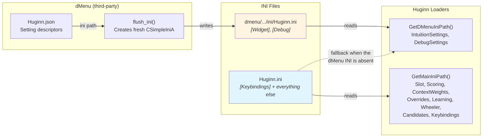
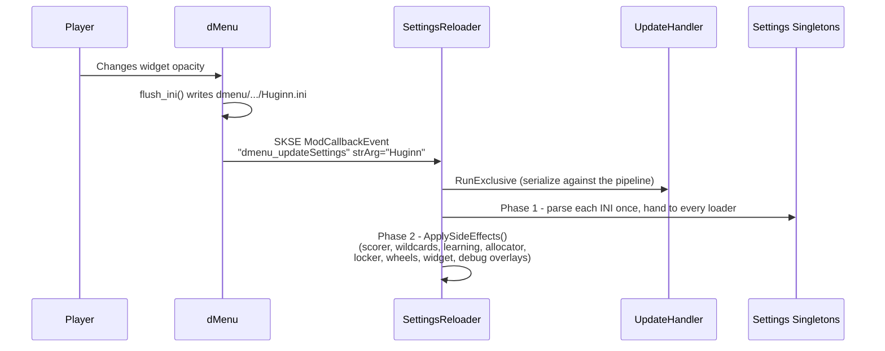

# dMenu Integration

> **R11 (0.24.4):** the "Reset Learned Weights" button returns θ to the bootstrap and clears b (and the old learner, D2's input), as `hg reset weights`; its text says so since R11. The `[Scoring]` and `[ContextWeights]` sections in the ownership table (main INI, re-read by `hg reload` / the Reload INI button) are D2's inputs only; the panels themselves expose `[Widget]` and `[Debug]` (the hand-tuned engine (context weights × the bandit's learning score × multipliers) no longer ranks: every candidate is ranked on the choice score μ (θ over need × effect columns, b per item; doc 9, [9-implementation-map.md](9-implementation-map.md)), and the old engine runs only for the D2 feature `ln learn mult` (`[Scoring] bLegacyLearnFeature`, confined by `tools/prune/r8_check.py`)).

> **0.24.10: one source of defaults; Reset to Defaults restores the shipped files.** The shipped `configs/Huginn.ini` and the dMenu descriptor are compiled into the DLL (`cmake/EmbedShipped.cmake`). Every main-INI read is the shipped Huginn.ini with the player's file over it, and every `[Widget]`/`[Debug]` read is the descriptor's defaults with dMenu's INI over them (`settings/ShippedDefaults.h`, `settings/IniOverlay.h`), so a key a file leaves out reads its shipped value, never a loader constant. Reset to Defaults writes the shipped files back to disk (keeping timestamped `.bak` copies) and loads them, so it persists. See [Reset to Defaults](#reset-to-defaults).

How Huginn integrates with [dMenu](https://www.nexusmods.com/skyrimspecialedition/mods/97221)
for in-game settings management, and what a settings reload actually does.

> **Verified against v0.19.10.** The INI ownership split described here was
> committed at 0.18.47 (`5e3242c`) and shipped in the **0.19.0** cut the same day
> (`b877606`, which also added the Show/Hide Widget button); the roadmap refers to
> it as "the 0.19.0 ownership split". It replaced the older "dMenu owns Widget + Keybindings +
> Debug, with the main INI as a fallback" arrangement that earlier revisions of
> this document described. The layout-gated Wheeler rebuild landed in **0.18.0**
> (`0f452a8`); its narrowing to a separate position check landed in **0.19.5**
> (`38969cb`).

> **Related documentation:**
> - [0-pipeline.md](0-pipeline.md) — recommendation pipeline (the reload serializes against its update loop)
> - [5-slots.md](5-slots.md) — slot system (page layout comes from the main INI)
> - [6-ui-ux.md](6-ui-ux.md) — Intuition widget and Wheeler integration
> - [Console commands](../../CLAUDE.md#console-commands) — `hg reload`, `hg rebuild`, `hg reset weights`

---

## Overview

dMenu is a third-party SKSE plugin that provides an in-game settings UI for
Skyrim mods. Huginn registers with dMenu via a JSON descriptor, so players can
adjust widget position, appearance and debug visibility, and fire action buttons,
without editing INI files by hand.

**Zero-coupling integration:** no headers, no DLL linking, no compile-time
dependency. Communication is entirely through a JSON descriptor file and SKSE
`ModCallbackEvent` messages.

**Graceful degradation:**

| Situation | Behaviour |
|---|---|
| dMenu not installed | No events fire. `GetDMenuIniPath()` falls back to the main INI, which does not define `[Widget]`/`[Debug]`, so those take the descriptor's defaults (compiled in); everything else loads from `Huginn.ini` as normal |
| dMenu installed, no JSON | Huginn's panel doesn't appear in dMenu; same as above |
| dMenu installed with JSON | Full hot-reload through the dMenu UI |

Because the fallback resolves to the main INI, a hand-written `[Widget]` or
`[Debug]` section added to `Huginn.ini` *is* read when dMenu is absent — the
shipped `configs/Huginn.ini` simply doesn't define one (`GetDMenuIniPath` in
`Globals.cpp`, `Settings::LoadDMenuIni`).

`SettingsReloader::ReloadAllSettings` is the **single source of truth for a full
reload**: the dMenu event handler, the dMenu "Reload INI" button and the
`hg reload` console command all delegate to it, so the paths cannot diverge
(`Cmd_Reload` in `ConsoleCommands.cpp`). The reload and Reset to Defaults
share one loader pass (`SettingsReloader::ApplyIni`), so they cannot load
different sets of settings either.

---

## INI ownership — exclusive, not layered



**One key, one home.** Nothing is defined in both files, and neither file
overrides the other (`SettingsReloader.h`, `SettingsReloader::ApplyIni`). That
is what makes it safe for dMenu to fire an update event *after* writing its own
INI: the reload cannot overwrite the value the player just changed.

**Each file over its shipped defaults (0.24.10).** The one layering there is
sits *under* each file, not between them: the main INI is parsed as the
shipped `configs/Huginn.ini` (compiled in) with the player's `Huginn.ini` over
it (`Settings::LoadMainIni`), and dMenu's INI as the descriptor's `"default"`
values with dMenu's file over them (`Settings::LoadDMenuIni`;
`core/DMenuDefaults.h` turns the descriptor into the INI dMenu itself writes on
a fresh install). A key the player's file sets wins; a key it leaves out, or a
missing file, reads the shipped value. So the default of every setting is the
line the shipped file states, and the loaders' fallback constants matter only
for a key in neither file or a value that does not parse (a NaN, an unknown
mode name). `tests/core/ShippedDefaultsTests.cpp` pins the layering on the real
shipped file, and a source guard there fails the build of the tests if a
settings INI is opened any other way.

| INI section | Owner file | Loader |
|---|---|---|
| `[Widget]` | dMenu INI | `UI::IntuitionSettings` |
| `[Debug]` | dMenu INI | `UI::DebugSettings` |
| `[Keybindings]` | **Main INI** | `Input::KeybindingSettings` |
| `[Pages]`, `[PageN]`, `[PageN.SlotM]` | Main INI | `Slot::SlotSettings` |
| `[Scoring]`, `[Favorites]` | Main INI | `Scoring::ScorerSettings` |
| `[ContextWeights]` | Main INI | `State::ContextWeightSettings` |
| `[Overrides]` | Main INI | `Override::Settings` |
| `[Learning]` | Main INI | `Learning::LearningSettings` |
| `[Wheeler]`, `[Subtexts]` | Main INI | `Wheeler::WheelerSettings` |
| `[Candidates]` | Main INI | `LoadCandidateConfigFromINI` **+ `CandidateGenerator::RefreshConfigFromGlobal()`** |
| `[Wildcards]` | Main INI | `LoadWildcardConfigFromINI` |
| `[SlotLocker]` | Main INI | `LoadSlotLockerConfigFromINI` |

`[Candidates]` is the one row with two entries, and it is a warning rather than
trivia. Its loader writes a **global**, and `CandidateGenerator` keeps a private
copy — so loading alone changes nothing. Until 0.19.13 the refresh call did not
exist anywhere, and the entire section was inert on both the reload path and the
game-load path. If another setting group ever grows a private consumer copy, it
needs the same second call, and the reload table is where that has to be visible.

### Why two files at all?

dMenu's `flush_ini()` creates a **fresh** `CSimpleIniA`, writes only the settings
dMenu tracks, then calls `SaveFile()`. The output therefore contains *only*
dMenu-managed sections.
Checked 2026-10-30 against the original dMenu source (D7ry/dMenu,
`src/bin/menus/ModSettings.cpp`, `flush_ini`: `CSimpleIniA ini; ...
ini.SetValue(...) per tracked setting; ini.SaveFile(...)`). The dMenu NG DLL
LoreRim ships (1.3.0, closed source) says on its Nexus page that its INI
saving "updates existing files instead of rebuilding them from scratch", so
under NG a shared file would survive -- but the split stays: Huginn has to
work with either DLL. If the original dMenu wrote directly to the main
`Huginn.ini`, every other section would be destroyed.

The JSON descriptor points dMenu at its own file, and Huginn reads each section
from exactly one place via two path helpers in `Globals.cpp`:

- `GetMainIniPath()` — `Data/SKSE/Plugins/Huginn.ini`; read only by
  `Settings::LoadMainIni` (over the shipped file) and written only by Reset to
  Defaults
- `GetDMenuIniPath()` — `Data/SKSE/Plugins/dmenu/customSettings/ini/Huginn.ini`
  (`GetDMenuOwnIniPath()`), falling back to the main INI when that file does
  not exist; handed only to `Settings::LoadDMenuIni`

> **Changed in 0.19.0:** keybindings used to be dMenu-managed. They are not any
> more — `[Keybindings]` lives in the main `Huginn.ini` only, dMenu no longer
> declares them, and `Main.cpp` loads them from the main INI (`Settings::LoadMainIni`).

---

## File layout

```
Data/SKSE/Plugins/
    Huginn.ini                              <- Main INI (never written by dMenu; Reset to Defaults
                                               writes the shipped file here)
    Huginn.ini.<YYYYMMDD-HHMMSS>.bak        <- the player's Huginn.ini before a Reset to Defaults,
                                               one per reset that changed it (all kept)
    Huginn_Overrides.ini                    <- Classification overrides (registry-time, NOT reloaded)
    dmenu/customSettings/
        Huginn.json                         <- dMenu descriptor (setting definitions + "ini" path)
        ini/
            Huginn.ini                      <- dMenu-managed INI ([Widget], [Debug] only)
            Huginn.ini.<stamp>.bak          <- it, before a Reset to Defaults that changed it
```

The repository copies live in `configs/Huginn.ini`, `configs/Huginn_Overrides.ini`
and `Data/SKSE/Plugins/dmenu/customSettings/Huginn.json`. The first and the
last are also compiled into the DLL (`cmake/EmbedShipped.cmake`, rerun when
either changes), as the defaults.

### Huginn.json

The descriptor defines:

- **`"ini"` path** — `Data\SKSE\Plugins\dmenu\customSettings\ini\Huginn.ini`
- **Groups** — *Intuition Widget*, *Debug & Logging*, *Actions*
- **Setting types** — `checkbox`, `slider`, `dropdown`, `button`
- **Action buttons** — Show/Hide Widget, Reset Learned Weights, Reset to Defaults, Reload INI

The *Intuition Widget* group covers all ten `[Widget]` keys (`bEnabled`,
`fPositionX`, `fPositionY`, `fAlpha`, `fScale`, `fAlphaChild`, `bReadOnly`,
`bHideWhileWheelOpen`, `sDisplayMode`, `sSlotEffect`); *Debug & Logging* covers
`iRecommendationLog`, `bShowStateManager`, `bShowRegistry`, `bShowUtilityScorer`.

**Dropdowns serialize as an integer index, not a label.** dMenu writes
`sDisplayMode=0`, not `sDisplayMode=minimal`. `IntuitionSettings::LoadFromIni`
accepts both spellings, and the index order in the loader must stay in sync with
the `options` arrays in `Huginn.json` (`IntuitionSettings::LoadFromIni`).
`core/DMenuDefaults.h` writes the defaults the same way (a dropdown's index, a
slider as C's `%f` of the float: `28.000000`), matching what dMenu writes.

---

## Event flow



### Event types

| Event | Trigger | Handler |
|---|---|---|
| `dmenu_updateSettings` | Any slider/checkbox/dropdown change saved (`strArg == "Huginn"`), and once for every mod at `kDataLoaded` | `ReloadAllSettings(GetDMenuIniPath())` (`SettingsReloader::ProcessEvent`) |
| `dmenu_buttonCallback` | An action button was clicked | `HandleButtonCallback(strArg)` |

### Button callbacks

| Button ID | dMenu label | Action |
|---|---|---|
| `Huginn_toggle_widget` | Show/Hide Widget | `IntuitionMenu::ToggleUserHidden()` — deliberately the *same* latch the hotkey flips, not a parallel flag. Resets to shown on load; use `bEnabled` to turn the widget off for good |
| `Huginn_reset_weights` | Reset Learned Weights | `ResetLearningData()` — clears `FeatureBanditLearner`, returns the choice learner to the bootstrap (with no bootstrap: empties the THTA / BIAS carried from the load, 0.24.18) **and** resets `SlotLocker`, so locked slots stop pinning recommendations scored by the just-cleared table. Shared with `hg reset weights` |
| `Huginn_reset_defaults` | Reset to Defaults | `ResetAllToDefaults()` — writes the shipped `Huginn.ini` over the player's and the descriptor's defaults over dMenu's INI (old files kept as timestamped `.bak` copies), then loads the shipped files alone through the same pass as a reload: every setting, the page layout included, as a fresh install. Learned data is untouched. See [Reset to Defaults](#reset-to-defaults) |
| `Huginn_reload_ini` | Reload INI | `ReloadAllSettings(GetDMenuIniPath())`. dMenu-managed sections still come from the dMenu INI, so a manual reload does **not** reset the player's widget customizations |

An unknown button ID logs a warning and shows "Huginn: Unknown action (check logs)".

---

## Reset to Defaults

The button is the "I changed something, I don't know what, put it all back"
switch. After it, the game behaves as a fresh install of the shipped files
would, now and after the next game start.

**What it does** (`SettingsReloader::ResetAllToDefaults`):

1. **Writes the shipped files to disk** (`Settings::RestoreShippedFiles`),
   outside the update mutex:
   - the compiled-in `configs/Huginn.ini` over `Data/SKSE/Plugins/Huginn.ini`
     (created if missing, as a fresh install has one);
   - the descriptor's defaults over dMenu's INI, **only if dMenu's INI exists**
     (dMenu creates it itself, at those same defaults, the first time it runs
     with `Huginn.json`; a player without dMenu gets no new file).

   A file that differs from what is written is first copied to
   `<name>.<YYYYMMDD-HHMMSS>.bak` (local time; a `-2`, `-3` ... suffix if a
   reset in the same second took the name). Backups are never deleted: the
   button is pressed rarely, and each is a file the player may want back. A
   file already the same is left alone and gets no backup -- `Huginn.ini`
   compared byte for byte (its comments are part of what is restored),
   dMenu's INI key by key (`core/DMenuDefaults.h` `SameIniContent`: BOM, CRLF,
   spacing, order and comments ignored), so a file dMenu re-saved at the
   defaults counts as reset. The new file is written to `<name>.tmp` and
   renamed over the old one (in place if the rename fails; the backup is made
   first either way). If a backup or a write
   fails, that file is left as it was, the log says which, and the
   notification says the reset holds for this session only.
2. **Loads the shipped files alone** (`LoadShippedMainIni` /
   `LoadShippedDMenuIni`; not re-read from disk, so a failed write still
   resets the session) through `ApplyIni`, the pass a reload uses: every
   settings class, the page layout (`[Pages]`: the shipped two pages, with the
   third, Kit, defined and off), keybindings, `[Widget]`, `[Debug]`,
   `[Wheeler]`, `[Needs]`, `[Scoring]`, `[ContextWeights]`, `[Candidates]`,
   `[Overrides]`, `[Learning]`, `[Wildcards]`, `[SlotLocker]`, `[Subtexts]`,
   `[Favorites]`.
3. **Side effects as a reload**, plus two for a fresh start: the Wheeler
   wheels are always rebuilt at `sWheelPosition` and a position the player
   dragged them to this session is forgotten, and the widget's hide latch (the
   hotkey / Show-Hide button) is cleared.

**Not touched:** learned data (the cosave's THTA / BIAS / BNDW, the old
learner) — that is Reset Learned Weights; `Huginn_Overrides.ini` and the
effect override directory; `Huginn_Bootstrap.json`. A curve the bootstrap
carries still replaces its `[Needs]` line, as on any load.

**Persistence, file by file:**

| File | Who writes it | After the button |
|---|---|---|
| `Data/SKSE/Plugins/Huginn.ini` | Huginn (only here); never dMenu | The shipped file. The next load, reload or dMenu change reads it |
| dMenu's `ini/Huginn.ini` | dMenu on every save of its panel; Huginn here | The descriptor's defaults on disk. **dMenu's panel still shows the old values until the game restarts** (below) |

**The dMenu caveat.** dMenu reads its INI for every mod once, when SKSE
loads it, keeps the values in memory, and on a save of its panel (Save, or
Auto Save) writes *all* of a mod's values from memory (D7ry/dMenu
`ModSettings::init` / `load_ini` / `flush_ini`; dMenu NG keeps the same
`load_ini` / `flush_ini` / `dmenu_updateSettings` flow, by its strings).
It has no way for another plugin to tell it to re-read the file or reset its
values. So after the button, in the same session, the panel still shows the
old `[Widget]`/`[Debug]` values, and changing any Huginn setting in it would
write the old values back over the reset (and Huginn would load them, as it
loads any dMenu change). The main `Huginn.ini` is not affected: dMenu never
writes it. A second notification says to restart before changing the panel;
after a restart dMenu reads the reset file. (dMenu's own per-entry reset,
hovering an entry and pressing R, sets that entry to the same descriptor
default.)

**Under MO2** the writes go through the virtual file system: the new
`Huginn.ini` lands where usvfs puts a write to an existing file (the file's
mod folder, or Overwrite), and the `.bak` (and the transient `.tmp`) files, being new, in Overwrite.
Either way the game sees the new file. Huginn never writes anywhere but the
two settings files and their `.bak` / `.tmp` siblings.

## What a reload does — and does not — rebuild

**Re-read and applied:**

- Every section in the ownership table above
- `UtilityScorer` config, context-weight config and wildcard config
- `ExternalEquipLearner` config
- `SlotAllocator::Initialize()` — re-reads the page count and re-validates
  override placeability. Note it also resets the current page to 0
  (`SlotAllocator.cpp:51`), so a reload sends the player back to the first page
- `SlotLocker::Reset()` + `SetConfig()` — all locks dropped, so the first tick
  after the reload can reassign every slot and the player sees the change within
  roughly one update interval (~100 ms)
- Intuition widget position/alpha/scale/effects, via `IntuitionMenu::ReapplySettings`
- Debug overlay visibility, via `DebugSettings::ApplyToWidgets()`
- Keybindings, pushed into `InputHandler::SetKeyCodes()`

**Not touched by a reload:**

| Not rebuilt | How to refresh it instead |
|---|---|
| Spell/item/weapon/scroll registries | `hg rebuild` (or `hg reset all`) |
| `Huginn_Overrides.ini` classification overrides — read at registry build time only | `hg rebuild`, which re-reads the file (`SpellRegistry.cpp:74`) |
| Learned weights in `FeatureBanditLearner` | `hg reset weights`, or the Reset Learned Weights button |
| Wheeler wheels, **when the wheel layout is unchanged** | see below |
| Cosave contents | untouched; a reload is settings-only |

---

## The Wheeler rebuild is gated on the wheel *layout*

This is the part that surprises people: **`hg reload` with no layout change does
not tear the wheels down.** That is deliberate.

Wheel *creation* depends on exactly two things — the wheel position, and, per
page, the page name and its slot count. Everything else Wheeler reads (subtext
labels, auto-focus, post-activation policy) is applied per-tick and needs no
rebuild. So `SettingsReloader` snapshots that much before the reload and compares
after:

```cpp
struct WheelLayout                                       // SettingsReloader.h:111
{
    int32_t wheelPosition = 0;
    std::vector<std::pair<std::string, size_t>> pages;   // (name, slot count)
    bool operator==(const WheelLayout&) const = default;
};
```

`CaptureWheelLayout()` reads `WheelerSettings::GetAPIPosition()` and every page's
name and slot count (`SettingsReloader.cpp:293`). The comparison happens inside
`ApplySideEffects`, and only when Wheeler is actually connected:

```cpp
if (afterLayout != beforeLayout) {                       // SettingsReloader.cpp:361
    wheelerClient.DestroyRecommendationWheels();
    if (positionRestated) {
        wheelerClient.ForgetWheelPositionMemory();
    }
    wheelerClient.CreateRecommendationWheels();
} else {
    // Structure unchanged: don't tear down valid wheels. Create is idempotent —
    // it no-ops when wheels are valid, or recreates them if they went missing.
    wheelerClient.CreateRecommendationWheels();
}
```

Two decisions, deliberately keyed on different things:

| Decision | Keyed on |
|---|---|
| Rebuild the wheels | the **whole** `WheelLayout` differs — a renamed page or a changed slot count needs new wheels — or Reset to Defaults |
| Forget a player-dragged wheel position | **only** `wheelPosition` differs (`positionRestated`), or Reset to Defaults |

Keying the *forget* on the full comparison was a bug: `WheelLayout` also carries
every page name and slot count, so editing something unrelated (`iPage2Slots`, a
page rename) and running `hg reload` threw away a position the player had set by
dragging, and the wheels jumped back to `sWheelPosition`. Narrowed in 0.19.5.

Ordering also matters: the forget must land **after** `DestroyRecommendationWheels()`,
not before. The destroy re-reads the live indices and can record the anchor again,
so forgetting first is undone in the same breath — observed 2026-08-28 with the
calls the other way round (`Forgetting remembered wheel position 1` and
`Remembering wheel position 1 (was -1)` in the same millisecond).

**What you see in the log** (debug level):

```
[SettingsReloader]   [Wheeler] layout unchanged, skipped rebuild
[SettingsReloader]   [Wheeler] wheels rebuilt (layout changed, position restated: true)
```

If you changed a scoring weight and expected the wheels to be recreated, the
first line is the system working as intended.

---

## Initialization timing

```
kDataLoaded (plugin init, before the main menu)
    |-- SettingsReloader::Register()
    |     subscribes to ModCallbackEvent
    |-- LoadDMenuIni(GetDMenuIniPath()) -> DebugSettings, IntuitionSettings
    |     early load so dMenu toggles apply before a save is loaded
    +-- LoadMainIni -> KeybindingSettings::LoadFromIni
          + InputHandler::SetKeyCodes()

kPostLoadGame / kNewGame  ->  InitializeGameSystems()
    |-- LoadMainIni ONCE (shipped + player's), distribute to every loader
    |     WheelerSettings, SlotSettings, ScorerSettings, ContextWeightSettings,
    |     NeedSettings, Override::Settings, LearningSettings, CandidateConfig,
    |     wildcards, ChoiceSettings; the SlotLocker config at step 8, after
    |     ResetPipelineSubsystems (which resets the locks, not the config)
    +-- LoadDMenuIni ONCE (descriptor defaults + dMenu's INI)
          IntuitionSettings (then IntuitionMenu::Show()), DebugSettings + ApplyToWidgets()
```

Debug widget visibility and keybindings are loaded early, at `kDataLoaded`, so
dMenu toggles and slot/page keys work from the main menu. The second load at game
init is harmless — it re-reads the same values.

---

## SettingsReloader

Singleton event sink, registered at `kDataLoaded`
(`src/settings/SettingsReloader.h`, `src/settings/SettingsReloader.cpp`).

```
SettingsReloader
|-- Register()                  <- subscribes to ModCallbackEvent (idempotent, warns on re-entry)
|-- IsRegistered()              <- atomic registration state
|-- ProcessEvent()              <- SKSE event handler
|   |-- "dmenu_updateSettings" (strArg == "Huginn") -> ReloadAllSettings(GetDMenuIniPath())
|   +-- "dmenu_buttonCallback"                      -> HandleButtonCallback(id)
|-- ReloadAllSettings(dMenuIniPath)      <- PUBLIC entry point; wraps RunExclusive
|   +-- ReloadAllSettingsExclusive()     <- requires the update mutex
|       |-- LoadMainIni / LoadDMenuIni       (each file over its shipped defaults)
|       +-- ApplyIni(mainIni, dMenuIni, reset = false)
|-- ResetLearningData()         <- STATIC; clears FeatureBanditLearner + resets SlotLocker.
|                                  Shared by `hg reset weights` and the dMenu button.
|                                  Returns nullopt when the learner isn't initialized
|-- HandleButtonCallback()      <- dispatches the four action buttons
|-- ResetAllToDefaults()        <- RestoreShippedFiles() (disk, outside the lock), then RunExclusive
|   +-- ResetAllToDefaultsExclusive()
|       |-- LoadShippedMainIni / LoadShippedDMenuIni   (the shipped layers alone)
|       +-- ApplyIni(mainIni, dMenuIni, reset = true)
|-- ApplyIni(mainIni, dMenuIni, reset)   <- the one loader pass, shared
|       |-- CaptureWheelLayout()             (before)
|       |-- Phase 1: every loader
|       |     mainIni:  SlotSettings, ScorerSettings, ContextWeightSettings, NeedSettings,
|       |               Override::Settings, LearningSettings, WheelerSettings,
|       |               CandidateConfig, KeybindingSettings
|       |     dMenuIni: IntuitionSettings, DebugSettings
|       +-- Phase 2: ApplySideEffects(mainIni, layoutBefore, wasEnabled, reset)
+-- ApplySideEffects(mainIni, beforeLayout, wasEnabled, reset)
```

Each INI is parsed **once** per reload and handed to every loader via
`LoadFromIni(const CSimpleIniA&)`, rather than each settings class re-opening the
file (9+ parses per load before `866f7bb`). `Settings::LoadMainIni` /
`LoadDMenuIni` (`src/settings/ShippedDefaults.h`) are the settings files' parse
front door; `LoadIniFile` (`src/IniLoad.h`) is for the other files.
`ApplySideEffects` takes the already-parsed main INI so the wildcard,
slot-locker and choice-learner loaders reuse it.

Graceful degradation inside the reload: a missing dMenu INI reads the
descriptor's defaults; a missing main INI reads the shipped `Huginn.ini` (a
warning says so), so every loader still loads, at the shipped values.

### ApplySideEffects order

Ordered to avoid inconsistent intermediate state (`SettingsReloader.cpp:308`):

1. **Scorer** — `UtilityScorer::SetConfig()` + `SetContextWeightConfig()` + `LoadWildcardConfigFromINI()`
2. **Learning** — `ExternalEquipLearner::SetConfig()` from `LearningSettings::BuildConfig()`
3. **Slot allocator** — `SlotAllocator::Initialize()` (re-reads the page count) — *first*, so the locker sees the right slot count
4. **Slot locker** — `SlotLocker::Reset()` then `SetConfig()`
5. **Wheeler wheels** — rebuild only if the layout changed (see above); `CreateRecommendationWheels()` is idempotent otherwise
6. **Intuition widget** — `ReapplySettings(IntuitionConfig)`; skipped with a debug line if the menu isn't up
7. **Debug overlays** — `DebugSettings::ApplyToWidgets()` (`LoadFromIni` is a pure loader; this is the apply step)

### Thread safety

`ReloadAllSettings` and `ResetAllToDefaults` **serialize themselves** against the
update loop via `UpdateHandler::RunExclusive`, in the callee, so no caller can
forget it. This is load-bearing rather than belt-and-braces: dMenu dispatches
`ModCallbackEvent` with no thread guarantee, and Phase 1 reassigns non-POD
settings (`std::string` members) that the pipeline reads every tick.

The corollary is that **callers must not wrap these calls in `RunExclusive`
themselves** — the update mutex is not re-entrant, and a caller-side wrap
deadlocks. Both `Cmd_Reload` (`ConsoleCommands.cpp:307`) and `Cmd_ResetQValues`
(`ConsoleCommands.cpp:76`) carry that warning in their comments.

`SlotSettings` additionally has its own `shared_mutex` for page layouts. POD
settings singletons (`ScorerSettings`, `ContextWeightSettings`) are read without
locks; the update mutex is what makes that safe.

---

## Key implementation files

| File | Role |
|---|---|
| `src/settings/SettingsReloader.h` / `.cpp` | Event sink, reload orchestration, Reset to Defaults, button dispatch, wheel-layout gating, side effects |
| `src/settings/ShippedDefaults.h` / `.cpp` | `LoadMainIni` / `LoadDMenuIni` (each file over its shipped defaults), `RestoreShippedFiles` (Reset to Defaults' writes and timestamped `.bak` copies) |
| `src/settings/IniOverlay.h` | The layering itself (SimpleIni only; host-tested) |
| `src/core/DMenuDefaults.h` / `.cpp` | The descriptor's defaults as dMenu writes them (host-tested) |
| `cmake/EmbedShipped.cmake` | Compiles `configs/Huginn.ini` and `Huginn.json` into the DLL |
| `tests/core/ShippedDefaultsTests.cpp` | Embedded bytes = repo files; the overlay on the real shipped file; the descriptor's defaults; the source guard |
| `src/Globals.cpp` | `GetMainIniPath()`, `GetDMenuIniPath()`, `GetDMenuOwnIniPath()`, `LoadIniFile()`, `LoadCandidateConfigFromINI()`, `LoadSlotLockerConfigFromINI()`, `LoadWildcardConfigFromINI()` |
| `src/IniLoad.h` | INI parse front door for the non-settings files + `ReadClampedFloat` |
| `src/Main.cpp` | `InitializeGameSystems()` (parse-once load at game init), early `[Debug]`/`[Widget]` + keybindings load at `kDataLoaded` |
| `src/console/ConsoleCommands.cpp` | `hg reload`, `hg rebuild`, `hg reset weights` — all delegating to the shared entry points |
| `Data/SKSE/Plugins/dmenu/customSettings/Huginn.json` | dMenu UI descriptor |
| `configs/Huginn.ini` | Main INI shipped with the mod; compiled in as every main-INI key's default |

---

## Extending dMenu settings

### Adding a new dMenu-managed setting

1. Add the entry to `Huginn.json` under the appropriate group. Its `"default"`
   is the default Huginn reads (`core/DMenuDefaults.h`) and Reset to Defaults
   writes; update the expected list in `ShippedDefaultsTests.cpp`.
2. Make its `"ini"` section/id match the keys the settings class reads in
   `LoadFromIni()`. Only `[Widget]` and `[Debug]` are dMenu-owned — a new section
   means a new ownership decision, not a default.
3. In `SettingsReloader::ReloadAllSettingsExclusive()`, load it from `dMenuIni`,
   not `mainIni`.
4. In `Main.cpp::InitializeGameSystems()`, load it from the dMenu INI parse.
5. For a dropdown, remember dMenu writes the **index**; mirror the `options` order
   in the loader and keep accepting the legacy name spelling.

### Adding a new non-dMenu setting

1. Add the section/keys to `configs/Huginn.ini`. Its value there **is** the
   default: every load reads the shipped file under the player's, and Reset to
   Defaults restores it. Give the loader's fallback the same value anyway; it
   only applies to a key in neither file or a value that does not parse.
2. Load from `mainIni` in `ReloadAllSettingsExclusive()` and from the main-INI
   parse in `InitializeGameSystems()`.
3. Do **not** add it to `Huginn.json` — dMenu's `flush_ini()` would claim ownership
   of the section, which is exactly what the split exists to prevent.
4. If it needs to reach a running subsystem, add the apply step to
   `ApplySideEffects()`. If it changes the wheel structure, it must also become
   part of `WheelLayout` or the rebuild will be skipped.

### Moving a setting between files

Move it, don't duplicate it. The invariant is that no key is defined in both
files; a key present in both re-introduces the overwrite bug the split fixed —
dMenu's own update event would reload the main INI's stale value over the change
the player just made.
